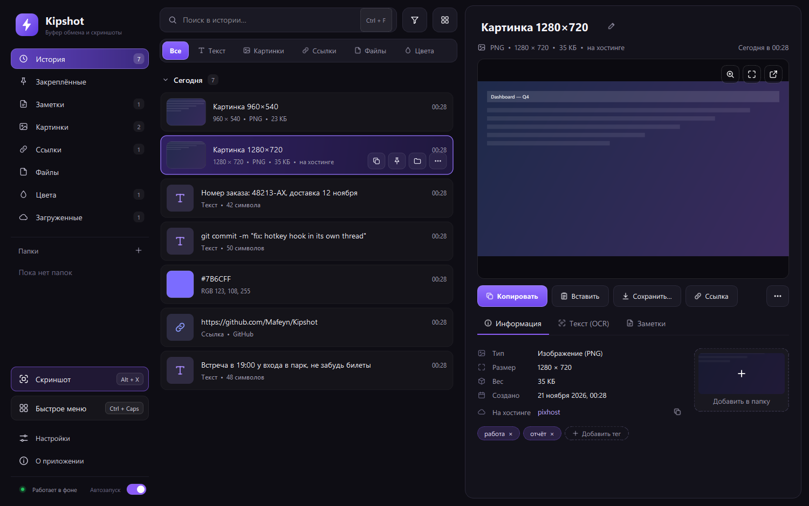
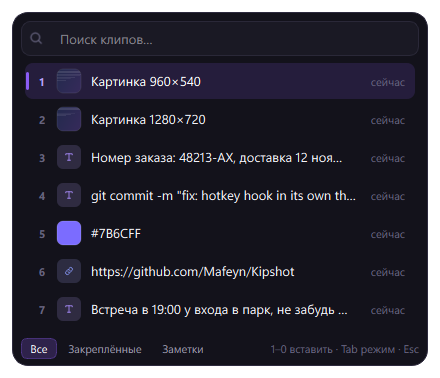

# Kipshot

История буфера обмена и скриншоты как в ShareX — в одной программе для Windows.



## Что умеет

- **История буфера.** Запоминает всё, что вы копируете: текст, ссылки, цвета, картинки, файлы. Группы «Сегодня / Вчера», фильтры по типу, поиск (в том числе по тегам и заметкам), список или плитка, закрепление и свои папки.
- **Удобная карточка записи.** Справа — предпросмотр под тип содержимого: картинка с увеличением, текст с правкой, ссылка, файлы, цвет в HEX/RGB/HSL. Кнопки «Копировать», «Вставить» (сразу в окно, где вы были), «Сохранить», «Загрузить». Вкладки «Информация», «Текст (OCR)» и «Заметки», теги.
- **Быстрое меню — `Ctrl+CapsLock`.** Открывается поверх любого окна, цифры `1`–`0` сразу вставляют нужное. Вкладки «Все / Закреплённые / Заметки», предпросмотр.
- **Скриншоты — `Alt+X`.** Выделение области или окна, лупа, пипетка цвета. После выделения — панель рисования: стрелки, линии, рамки, текст, нумерация шагов, маркер, размытие, ластик, отмена.
- **Сохранение и ссылки.** Скриншот сохраняется в PNG без потерь (по папкам месяцев) и сам загружается на хостинг без регистрации — ссылка сразу в буфере. Если хостинг не отвечает, Kipshot пробует следующий (pixhost.to → freeimage.host → catbox.moe).
- **Текст с картинки.** Вкладка «Текст (OCR)» распознаёт русский и английский текст на скриншоте (встроенный OCR Windows, без интернета).
- Тёмный интерфейс в стиле Windows 11, работа из трея, автозапуск одним переключателем.



## Установка

Скачайте последнюю версию на странице [Releases](../../releases):

- **`Kipshot_Setup_x.y.z.exe`** — установщик (ярлыки, автозапуск, удаление через «Приложения»);
- **`Kipshot_Portable.exe`** — один файл, работает без установки.

Windows может показать предупреждение SmartScreen, потому что файл не подписан: «Подробнее» → «Выполнить в любом случае».

## Горячие клавиши

| Клавиши | Действие |
|---|---|
| `Ctrl+CapsLock` | быстрое меню истории (меняется в настройках) |
| `Alt+X` | скриншот области или окна |
| `1`–`0`, `Enter` | вставить элемент из меню |
| `Tab` | переключить вкладку в меню |
| `Ctrl+P` | закрепить |
| `Esc` | закрыть |

В режиме скриншота: `P` карандаш, `M` маркер, `L` линия, `A` стрелка, `R` прямоугольник, `E` эллипс, `T` текст, `N` номер шага, `B` размытие, `X` ластик, `Ctrl+Z / Ctrl+Y` отмена и повтор, `Shift` — ровные углы, `Enter` — готово.

## Сборка из исходников

Нужен Windows 10/11. Запустите **`BUILD_Kipshot.bat`** — он сам поставит Python 3.12, PySide6 и PyInstaller (и Inno Setup для установщика), а результат положит в папку `release`.

Или вручную:

```bash
pip install -r requirements.txt
python kipshot.py
```

## Где хранятся данные

История и настройки — `%APPDATA%\Kipshot\kipshot.db`, скриншоты — `Изображения\Kipshot`. Всё остаётся на вашем компьютере; в интернет уходят только скриншоты, которые вы загружаете на хостинг (автозагрузку можно выключить в настройках).
